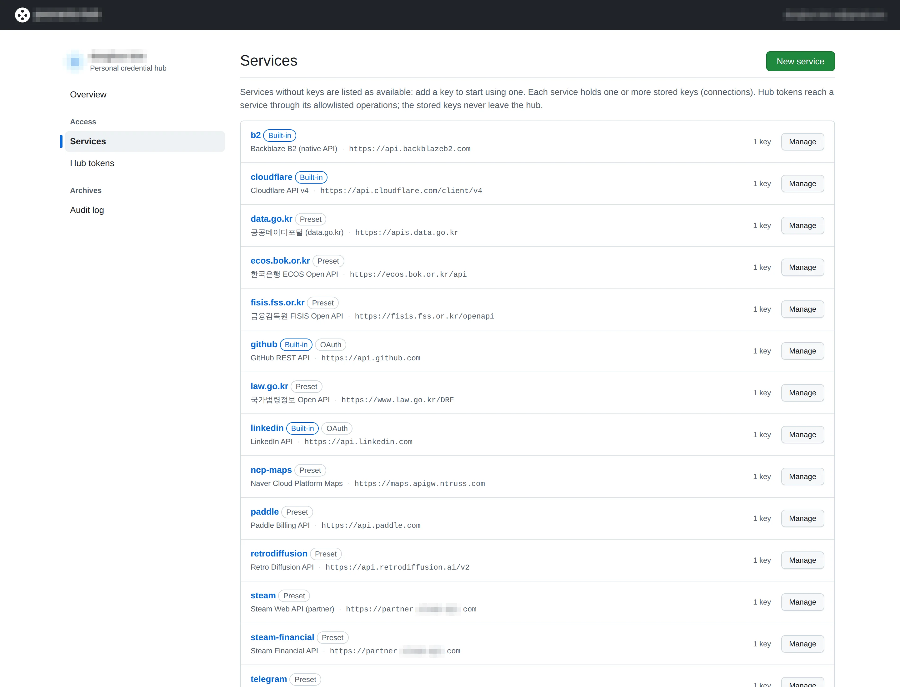
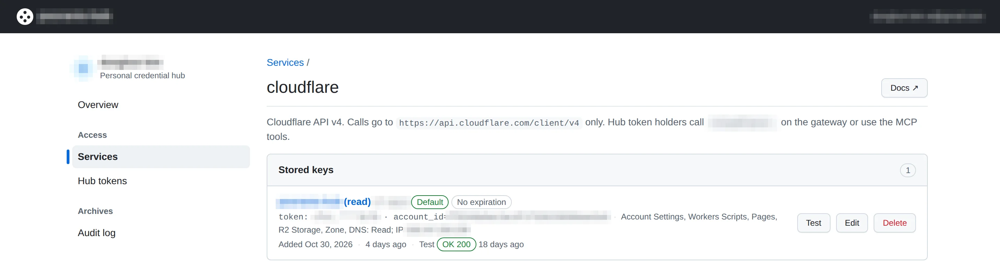
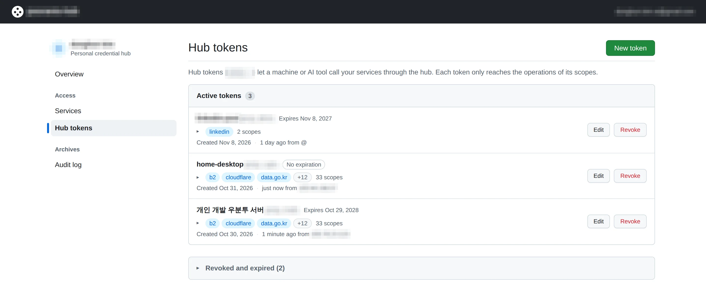
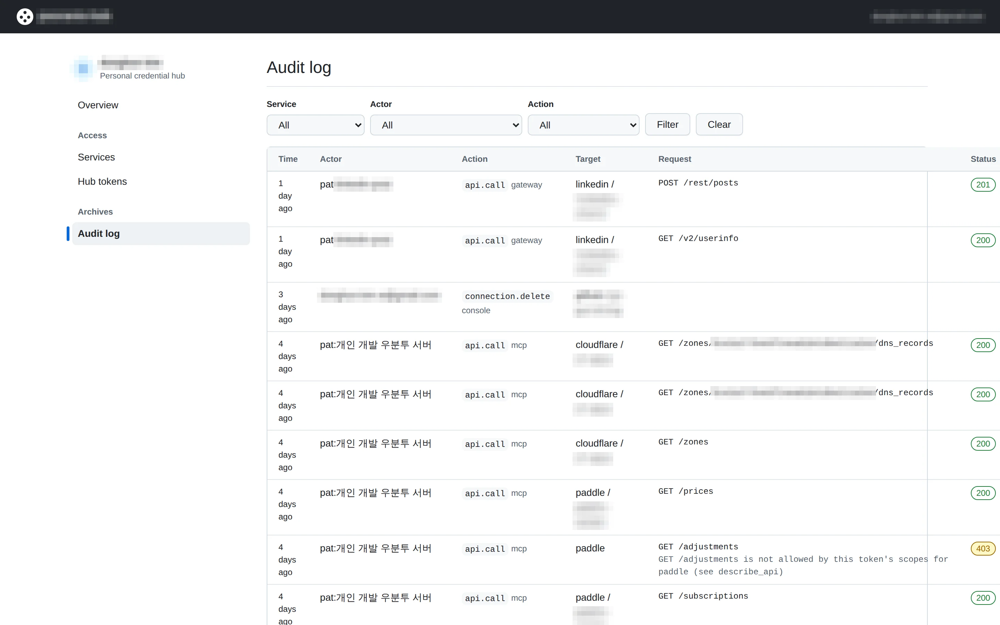

+++
title = "I moved my API keys into one hub, and my agents stopped seeing them"
date = 2026-11-18T00:00:00+09:00
draft = false
tags = ["mcp", "ai-agent", "security", "secrets-management", "platform-engineering"]
description = "I moved my personal API keys into a hub on one server. Rotating a key no longer means visiting every PC, and agents carry one scoped token. Part 1: tokens and scopes."
+++

I use quite a few API keys for personal work: Cloudflare, Backblaze B2, LinkedIn, a Telegram bot, GitHub, a payment provider. Until last month they all lived in one file, and every PC I work on had its own copy. Even when an agent only needed to fix one DNS record, the process reading that file was also holding the LinkedIn token and the backup bucket key. I moved all of it into a hub on one server.

Now rotating a key doesn't mean walking around my PCs. Agents and scripts no longer carry the real keys; each carries one token that can do a fixed set of things. A request outside that set gets a 403 from the hub, and the refusal is logged. The hub currently holds 19 services and 15 keys, and the callers hold 3 tokens between them.

## Rotating a key no longer means visiting every PC

Before, changing one key meant one chore per PC. The keys sat in a single file, creds.json, and the original was an attachment on a Vaultwarden item. With a new key I updated the Vaultwarden attachment first, then downloaded the file again on each PC and set its mode to 600. Doing it in the wrong order let the two copies drift apart without anyone noticing; the README said so. The binary refused to run at all if other users could read the file, because file permissions were the only thing left to enforce.

Now I change the value in that key's field on the hub once. From the next call on, every PC and every server script uses the new key. There is no file on the PCs to change.

Every service in the list has one address its calls go to, and the hub sends requests nowhere else. Opening a key shows everything I want to know about it on one card. Only the first few and last four characters of the value are visible. Next to it: the permissions the key was granted on the provider's side, when it expires, when it was last used, and whether the last connection test passed. The Cloudflare key below was last used four days before the screenshot and returned 200 on a test 18 days before it. After rotating a key, one press of the Test button tells me whether the new one works.

The old code carried this comment: "Per-service separation is a discipline, not an enforcement. The real enforcement moved to the file's permissions." When one process holds every key, splitting services inside it is closer to a promise. On the day I moved to the hub, I deleted that local server and its install code, 3,023 lines.

## Agents carry one token

A script on a server posts to LinkedIn. It does not know the LinkedIn token. All it has is one hub token, and that token can do two things: read my profile and publish a post. The script sends its request to the hub, and the hub inserts the real LinkedIn token and forwards the request to LinkedIn. On the way back, headers carrying cookies or tokens are stripped.

How the key is inserted differs by service. Most take it in a header; some want it in the query string, and a Telegram bot wants it in the middle of the URL path. B2 first needs the key exchanged for a temporary token, so the hub does that exchange itself and holds the result for 23 hours. The hub knows all of these differences. Callers send the same token in the same header to every service.

The token format follows GitHub's personal access tokens: a fixed prefix, 30 random characters and a 6-character checksum. The checksum lets secret scanners reject typos and fakes without asking the server. The value is shown once, right after it is issued, and the hub keeps only its hash. The default lifetime is 90 days.

Three tokens are in use. The LinkedIn script's token has two scopes and expires in a year. The other two are tokens I use myself, on my home PC and my development server, and honestly they are wide open: 33 scopes each, and the home PC token never expires. Cutting the token narrow on a machine I sit at every day would send me back to edit its scopes several times a day. In exchange, the screen shows at a glance which token opens what, and if I lose that machine I delete that one token. Wide tokens for people, narrow tokens for scripts that run alone. That is the split for now.

## A scope is not a label

A scope is written one at a time in the form `service:resource:read|write`, such as `linkedin:post:write` or `cloudflare:dns:write`. There are no wildcards. This is where I spent the longest during the design. The Cloudflare key the hub holds can touch Workers, Pages and R2, not just DNS. Writing `dns:write` on a token would be only a label. So each scope has its own list of allowed methods and paths, and every request is checked against it. A read scope cannot call a write path.

Where the hub sends requests is also fixed per service. It does not follow redirects, and it does not connect to internal or loopback addresses. The point is that someone holding a token cannot use the hub to probe the inside of my network. Keys that open an entire account, like Cloudflare's Global API Key, are refused outright; the hub asks for a token with a narrower scope instead.

## Writes ask once more

Agents use the same hub over MCP, through four tools. Three of them list the connected services, read a service's API description and send read requests. Write requests go through a separate fourth tool. It opens only for tokens with a write scope, and when the client supports it, it asks a person before running.

The reason for the split is a worry anyone using MCP shares: an instruction can hide in a web page or document the agent reads. If reads and writes share one tool, there is nowhere to stop that instruction when it says to delete a DNS record. With separate tools, at least the moment of writing stands out. Connecting a new service needs no MCP reconfiguration; it simply appears in the service list in the next session.

Every call through the hub is logged: who, with which token, over MCP or from a script, which path of which service, and with what result. Request bodies, query strings and the inserted keys are not recorded. Requests refused for being out of scope are logged as well. Four days before the screenshot, an agent tried over MCP to read the payment provider's adjustments (`GET /adjustments`), and it was refused because that path is not in the token's scopes. The refusal tells the agent to call the API description tool to see which paths are allowed.

## Wrapping up

In [the post about moving MCP to a server](/en/blog/mcp-server-no-update-notice/) I wrote about gathering the team's internal system accounts into one dashboard. This one brings the same idea to my personal keys. The difference is that the other side is external services, not internal systems, so the key a service hands out is always broader than what I want. Half of what the hub does is cut that broad key down and pass on the narrow part. Some places are still wide open, like my PC tokens, but at least now the screen shows where.

Part 2 covers what sits outside the hub: where a new key goes first, who gets into the hub screen and how, and the steps that set up a new PC in a few commands.
