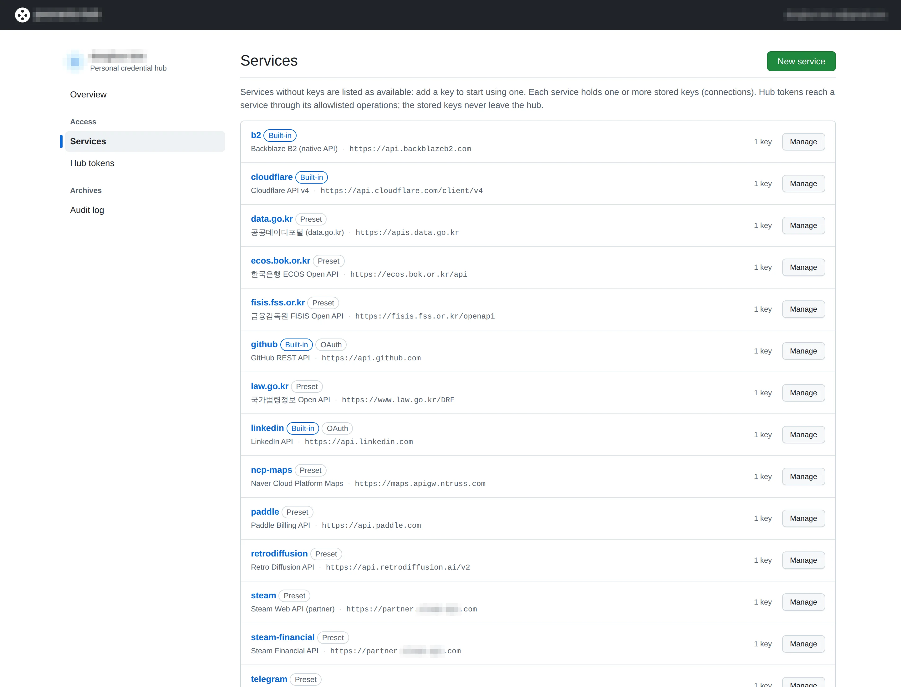
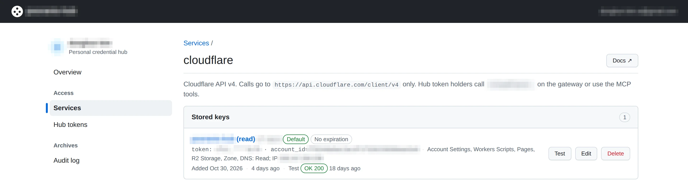
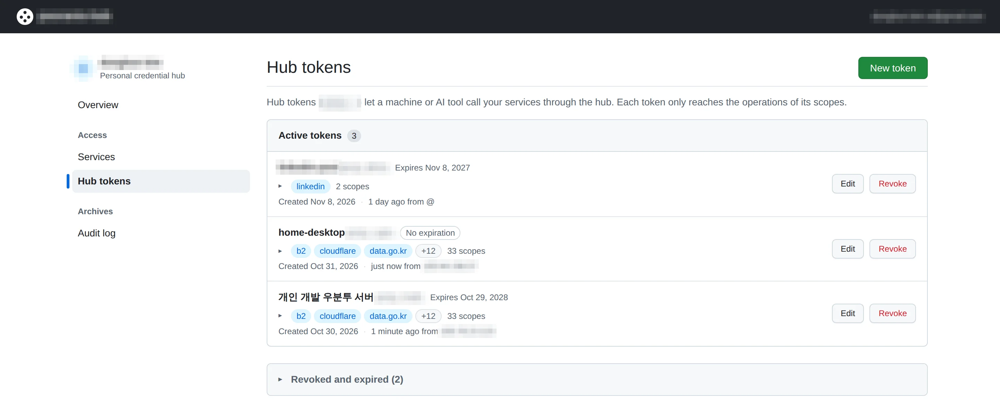
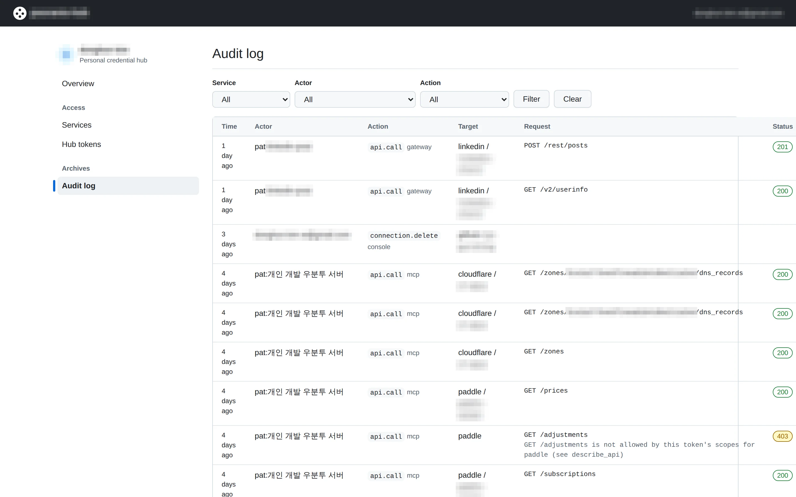

+++
title = "API 키를 허브 한 곳에 넣었더니, 에이전트가 키를 볼 일이 없어졌다"
date = 2026-11-20T00:00:00+09:00
draft = false
tags = ["mcp", "ai-agent", "security", "secrets-management", "platform-engineering"]
description = "개인적으로 쓰는 API 키를 서버 한 대의 허브로 옮겼다. 키를 바꾸는 날 PC 를 돌지 않고, 에이전트와 스크립트는 범위가 정해진 토큰 하나만 든다. 1부는 토큰과 권한 이야기."
+++

개인 작업에 쓰는 API 키가 꽤 된다. Cloudflare, Backblaze B2, LinkedIn, 텔레그램 봇, GitHub, 결제 대행사까지. 지난달까지 이 키들은 전부 파일 하나에 들어 있었고, 그 파일은 내가 쓰는 PC 마다 한 부씩 있었다. 에이전트가 DNS 레코드 하나를 고치려고 해도 그 파일을 읽는 프로세스는 LinkedIn 토큰과 백업 버킷 키까지 같이 들고 있었다. 이걸 서버 한 대의 허브로 옮겼다.

옮기고 나니 키를 바꾸는 날 PC 를 돌지 않는다. 에이전트와 스크립트는 진짜 키 대신 할 수 있는 일이 정해진 토큰 하나만 든다. 범위를 벗어난 요청은 허브가 403 으로 돌려보내고, 그 기록이 남는다. 지금 허브에는 서비스 19개, 키 15개가 들어 있고, 키를 쓰는 쪽이 가진 토큰은 3개다.

## 키를 바꾸는 날, PC 를 돌지 않는다

전에는 키 하나를 바꾸면 할 일이 PC 수만큼 늘었다. 키들은 creds.json 이라는 파일 하나에 모여 있었고, 원본은 Vaultwarden 항목의 첨부 파일이었다. 키를 새로 받으면 Vaultwarden 첨부부터 고치고, 각 PC 에서 그 파일을 다시 내려받아 권한을 600 으로 맞췄다. 순서를 어기면 두 사본이 소리 없이 어긋났다. README 에 그렇게 적혀 있었다. 바이너리는 다른 사용자가 읽을 수 있는 파일이면 아예 실행을 거부했다. 지킬 수 있는 것이 파일 권한뿐이었기 때문이다.

지금은 허브 화면에서 그 키 칸의 값을 한 번 바꾼다. 다음 호출부터 모든 PC 와 서버의 스크립트가 새 키를 쓴다. PC 에는 바꿀 파일이 없다.

서비스 목록에는 서비스마다 호출이 나갈 주소가 하나씩 박혀 있다. 허브는 그 주소로만 요청을 보낸다. 키 하나를 열면 그 키에 관해 알고 싶은 것이 한 장에 있다. 값은 앞 몇 글자와 끝 네 글자만 보인다. 그 키가 서비스 쪽에서 받은 권한이 무엇인지, 언제 만료되는지, 마지막으로 쓰인 게 언제인지, 마지막 연결 테스트가 통과했는지도 같이 보인다. 아래 Cloudflare 키는 캡처 나흘 전에 쓰였고, 18일 전 테스트에서 200 을 받았다. 키를 바꿨을 때 테스트 버튼을 한 번 누르면 새 키가 통하는지 바로 안다.

옛 코드에는 이런 주석이 있었다. "서비스별 차단은 규율일 뿐 강제가 아니다. 진짜 강제는 파일 권한으로 옮겨 갔다." 한 프로세스가 모든 키를 들고 있으면, 그 안에서 서비스를 나누는 것은 약속에 가깝다. 허브로 옮긴 날 그 로컬 서버와 설치 코드 3,023줄을 지웠다.

## 에이전트는 토큰 하나만 든다

LinkedIn 에 글을 올리는 스크립트가 서버에 있다. 이 스크립트는 LinkedIn 토큰을 모른다. 가진 것은 허브 토큰 하나이고, 그 토큰이 할 수 있는 일은 두 가지다. 내 프로필을 읽고, 글을 올리는 것. 스크립트가 허브에 요청을 보내면 허브가 진짜 LinkedIn 토큰을 끼워 넣어 LinkedIn 에 대신 보낸다. 응답이 돌아올 때 쿠키나 토큰이 담긴 헤더는 지우고 돌려준다.

키를 끼워 넣는 방식은 서비스마다 다르다. 대부분은 헤더에 넣지만, 쿼리 문자열에 넣는 곳도 있고, 텔레그램 봇처럼 주소 경로 한가운데에 키를 넣는 곳도 있다. B2 는 키로 먼저 임시 토큰을 받아 와야 해서, 허브가 그 교환을 대신 하고 23시간 동안 들고 있다. 이 차이는 전부 허브가 안다. 부르는 쪽은 어느 서비스든 같은 토큰을 같은 헤더에 넣어 보낸다.

토큰 모양은 GitHub 의 개인 토큰을 따랐다. 정해진 접두사 뒤에 무작위 30자, 끝에 체크섬 6자가 붙는다. 체크섬 덕분에 비밀 스캐너가 서버에 묻지 않고도 오타나 가짜를 걸러 낸다. 값은 발급 직후 한 번만 보이고, 허브에는 해시만 남는다. 기본 만료는 90일이다.

지금 쓰는 토큰은 셋이다. LinkedIn 스크립트용 토큰은 범위가 둘뿐이고 1년 뒤에 만료된다. 나머지 둘은 집 PC 와 개발 서버에서 내가 직접 쓰는 토큰인데, 솔직히 넓게 열어 두었다. 범위가 33개씩이고, 집 PC 용은 만료도 없다. 매일 붙어 앉아 쓰는 기계에 토큰을 좁게 잘라 두면 하루에도 몇 번씩 범위를 고치러 가야 했다. 대신 화면에서 어떤 토큰이 무엇을 열고 있는지가 한눈에 보이고, 그 기계를 잃어버리면 그 토큰 하나를 지운다. 사람이 쓰는 토큰은 넓게, 혼자 도는 스크립트의 토큰은 좁게. 지금은 그렇게 나눠 두었다.

## 범위는 이름표가 아니다

범위는 `서비스:자원:read|write` 꼴로 하나씩 적는다. `linkedin:post:write`, `cloudflare:dns:write` 처럼. 와일드카드는 없다. 처음 설계할 때 가장 오래 붙잡은 것이 여기였다. 허브가 들고 있는 Cloudflare 키는 DNS 말고도 Workers, Pages, R2 까지 만질 수 있다. 토큰에 `dns:write` 라고 적어 두기만 하면 그건 이름표일 뿐이다. 그래서 범위마다 허용하는 메서드와 경로 목록을 따로 두고, 요청이 올 때마다 그 목록에 맞춰 본다. 읽기 범위로는 쓰기 경로를 부를 수 없다.

허브가 요청을 보내는 곳도 서비스마다 고정했다. 리다이렉트는 따라가지 않고, 내부망이나 루프백 주소로는 나가지 않는다. 토큰이 있는 누군가가 허브를 시켜 내부를 두드리는 일을 막으려는 것이다. Cloudflare 의 전역 키처럼 계정 전체를 여는 키는 아예 받지 않는다. 범위를 좁힌 토큰을 만들어 오라고 돌려보낸다.

## 쓰기는 한 번 더 묻는다

에이전트는 같은 허브를 MCP 로 쓴다. 도구는 네 개뿐이다. 어떤 서비스가 붙어 있는지 보고, 그 서비스의 API 설명을 읽고, 읽기 요청을 보내는 도구가 셋. 쓰기 요청은 네 번째 도구로 따로 뺐다. 이 도구는 쓰기 범위가 있는 토큰에서만 열리고, 클라이언트가 지원하면 실행 전에 사람에게 한 번 더 묻는다.

나눈 이유는 MCP 를 쓰는 사람이라면 다 아는 걱정이다. 에이전트가 읽은 웹 페이지나 문서에 지시가 숨어 있을 수 있다. 읽기와 쓰기가 한 도구에 섞여 있으면 그 지시가 DNS 레코드를 지우라고 할 때 막을 자리가 없다. 도구가 나뉘어 있으면 적어도 쓰는 순간은 눈에 띈다. 서비스를 새로 붙여도 MCP 설정을 다시 할 필요는 없다. 다음 세션의 서비스 목록에 그냥 나타난다.

허브를 거치는 호출은 전부 기록에 남는다. 누가, 어떤 토큰으로, MCP 인지 스크립트인지, 어느 서비스의 어떤 경로를, 어떤 결과로 불렀는지. 요청 본문과 쿼리 문자열, 끼워 넣은 키는 남기지 않는다. 범위 밖이라 거부된 요청도 그대로 찍힌다. 캡처 나흘 전 에이전트가 MCP 로 결제 대행사의 조정 내역(`GET /adjustments`)을 읽으려 했고, 그 토큰의 범위에 없는 경로라 거부됐다. 거부 메시지는 어떤 경로가 허용되는지 보려면 API 설명 도구를 부르라고 안내한다.

## 마무리

[MCP 를 서버로 올린 이야기](/blog/mcp-server-no-update-notice/)에서는 팀이 쓰는 사내 시스템 계정을 대시보드 한 곳으로 모았다고 썼다. 이번 것은 그 생각을 내 개인 키에 가져온 것이다. 다른 점은 상대가 사내 시스템이 아니라 외부 서비스라는 것, 그래서 서비스가 준 키가 늘 내가 원하는 것보다 넓다는 것이다. 허브가 하는 일의 절반은 그 넓은 키를 좁게 잘라 건네는 일이다. 내 PC 용 토큰처럼 아직 넓게 열어 둔 곳도 있지만, 적어도 이제는 어디가 넓은지 화면에서 보인다.

2부에서는 허브 바깥 이야기를 한다. 키를 처음 받으면 어디에 먼저 두는지, 허브 화면에는 누가 어떻게 들어오는지, 그리고 새 PC 를 명령 몇 줄로 세팅하는 순서다.
