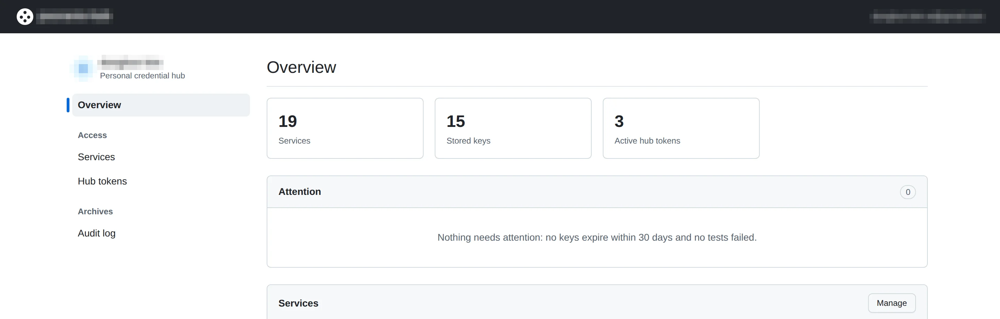
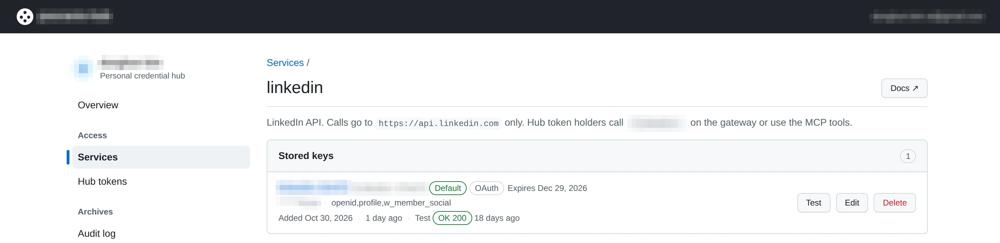

+++
title = "Setting up a new PC no longer asks me for a password"
date = 2026-11-23T00:00:00+09:00
draft = true
tags = ["mcp", "security", "tailscale", "secrets-management", "developer-experience"]
description = "Key originals live in Vaultwarden, working copies in the hub. The hub opens only on my tailnet, with no login page, and a new PC takes a few commands. Hub, part 2."
+++

Setting up a new PC used to include a separate step for moving keys. I signed in to Vaultwarden, downloaded the attachment, put it in place and fixed its permissions. That step is gone, because no key file ever lands on the new PC. I don't type a password at any point during setup either.

In [the post about putting my API keys into one hub](/en/blog/hub-api-keys-part1/) I described how agents and scripts carry one scoped token instead of the real keys. This time it's what sits outside the hub: where a new key goes first, who gets into the hub screen and how, and the steps that set up a new PC.

## Keys go to Vaultwarden first, and are used from the hub

When a service hands me a new API key, it goes into Vaultwarden first. Most services show a key once, right after issuing it, so the first job is to put it somewhere it can't be lost before that page closes. Then I paste it into that service's field on the hub screen, and the Test button next to the field tells me right away whether the key actually works. Keys that are too broad, like Cloudflare's Global API Key, are refused; the hub asks for a token with a narrower scope instead.

So the hub's front page shows only what needs managing: how many services, keys and tokens there are, and whether any key expires within 30 days or failed its test. When nothing does, it shows 0.



The roles are split. Vaultwarden keeps the originals; the hub is where they are used. Neither agents nor scripts can reach Vaultwarden. When I first moved to the hub I imported the keys from Vaultwarden in one go, and since then I add them one at a time.

Inside the hub, keys are sealed with AES-256-GCM. Each value is bound to the account, connection and field it belongs to, so a ciphertext copied into another row will not decrypt. The key file used for sealing sits apart from the database, and the hub refuses to start if its permissions are wider than 600. A copy of that key file is also in Vaultwarden, as a secure note rather than an attachment, because clients don't keep attachments offline. If the server disappears entirely, I don't want Vaultwarden to be locked along with it.

Backups go to B2 every week. The hub takes a copy while it keeps running, checks its integrity, and signs a manifest listing each file's hash. Once a month it is set to restore the latest backup for real and decrypt every sealed value. The first rehearsal, run by hand on the day I installed it, decrypted all 16 connections, 19 secrets and 5 tokens. The B2 key and the Vaultwarden master password are kept separately again, encrypted, somewhere else, so that losing the vault does not mean losing the backups too.

## The hub has no login page

People opening the hub screen for the first time usually look for a login form. There isn't one. The screen opens only inside my tailnet, and being on the tailnet is the login.

The hub listens only on a Unix socket on the server. The only way in from outside is one address that Tailscale opens inside the tailnet. When Tailscale forwards a request, it attaches the tailnet account of whoever sent it as a header. The hub lets that account in if it is on the owner list in its config, and turns it away otherwise. The tailnet account itself was created with a GitHub or Google sign-in, so passwords and two-factor authentication are handled there.

Trusting a person by a header has a condition: if anyone can write that header themselves, it means nothing. So the hub listens only where nothing but Tailscale can reach it. It started on loopback, and it now uses a socket so that other users on the same server can't reach it either. There is an option to expose it beyond the tailnet, but the setup document says "never use it".

Agents and scripts come in with a token, not through the screen. They have to be able to reach that address from inside the tailnet and hold a valid token. Either one alone is not enough.

## A new PC in a few commands

Here is what happens on a new PC. Claude Code, git and gh are installed beforehand, and `gh auth login` is done.

```bash
gh repo clone <my-setup-repo> && cd <repo> && ./install.sh   # .\install.ps1 on Windows
sudo tailscale up                                              # sign in through the browser
```

The install script gives the same result no matter how many times it runs. It installs my two plugins, turns on auto-update, and fetches the binary the hooks use, checking its checksum. It downloads no keys at all. Once the PC is on the tailnet, I open my knowledge store's setup page and follow it; that one is a single browser sign-in.

The hub comes last. Opening the hub screen inside the tailnet, I am already signed in. On the tokens page I create a token named after this PC and pick the scopes it needs. The issue page hands back the registration command as one line, with the token already filled in.

```bash
claude mcp add -s user --transport http hub https://<hub>/mcp \
  --header "Authorization: Bearer <token>"
```

Paste it, and once the hub shows as Connected in `claude mcp list`, setup is done. If I lose this PC, I revoke that one token. No service key ever reached this PC, so there is no key to change.

## What's still left

The token stays in `~/.claude.json` in plain text. The design relies on scope, expiry and revocation, not encryption. Next on the list is a CLI that fetches the token through a browser sign-in, which removes the one line of copying and pasting a token. Some service connections, like LinkedIn, already use OAuth, but most still need a key pasted by hand.



## Wrapping up

While designing it I found that similar things already exist. Nango, Composio and Auth0's Token Vault are heading the same way: handing agents a stand-in token instead of the real key. A hub used by one person is nowhere near their scale, but it was good to see the direction is the same.

Managing keys hasn't disappeared. I still put each new key into Vaultwarden and paste it into the hub. What changed is that this happens in one place. However many PCs or agents there are, keys live in only two places: the vault and the hub.
