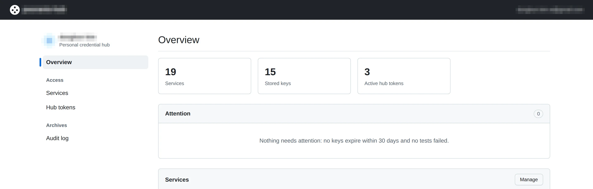
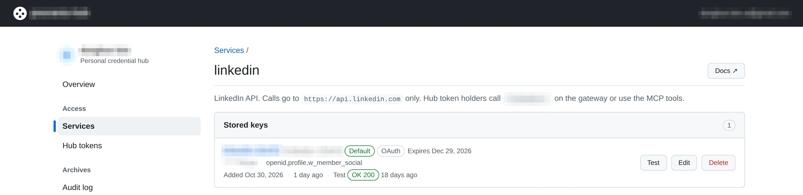

+++
title = "새 PC 세팅에서 비밀번호 입력이 사라졌다"
date = 2026-11-23T00:00:00+09:00
draft = true
tags = ["mcp", "security", "tailscale", "secrets-management", "developer-experience"]
description = "API 키는 Vaultwarden 에 원본, 허브에 사본. 허브 화면은 테일넷 안에서만 열리고 로그인 화면이 없다. 새 PC 는 명령 몇 줄과 토큰 한 줄로 끝난다. 허브 2부."
+++

새 PC 를 세팅하는 날, 예전에는 키를 옮기는 단계가 따로 있었다. Vaultwarden 에 로그인해 첨부 파일을 내려받고, 제자리에 두고, 권한을 맞췄다. 지금 그 단계는 없다. 새 PC 에 키 파일이 생기지 않기 때문이다. 세팅하는 동안 비밀번호를 치는 일도 없다.

[API 키를 허브 한 곳에 넣은 이야기](/blog/hub-api-keys-part1/)에서는 에이전트와 스크립트가 진짜 키 대신 범위가 정해진 토큰 하나만 드는 구조를 썼다. 이번에는 허브 바깥이다. 키를 처음 받으면 어디에 두는지, 허브 화면에는 누가 어떻게 들어오는지, 그리고 새 PC 를 세팅하는 순서다.

## 키는 Vaultwarden 에 먼저, 쓰는 건 허브에서

서비스에서 API 키를 새로 받으면 나는 먼저 Vaultwarden 에 넣는다. 대부분의 서비스는 키를 발급 직후 한 번만 보여 준다. 그 화면을 닫기 전에 잃지 않을 곳에 두는 것이 먼저다. 그다음 허브 화면에서 그 서비스 칸에 키를 붙여 넣는다. 칸 옆의 테스트 버튼으로 그 키가 실제로 통하는지 바로 확인한다. Cloudflare 의 전역 키처럼 너무 넓은 키는 아예 받지 않고, 범위를 좁힌 토큰을 만들어 오라고 한다.

허브 첫 화면은 그래서 관리할 것만 보여 준다. 서비스와 키, 토큰이 몇 개인지, 30일 안에 만료되는 키나 테스트에 실패한 키가 있는지. 아무것도 없으면 0 이 뜬다.



역할이 나뉜 셈이다. Vaultwarden 은 원본 보관소이고, 허브는 쓰는 곳이다. 에이전트도 스크립트도 Vaultwarden 에는 닿지 않는다. 처음 허브로 옮길 때는 Vaultwarden 에 있던 키들을 한꺼번에 들여왔고, 그 뒤로는 하나씩 추가했다.

허브 안의 키는 AES-256-GCM 으로 봉인한다. 값마다 어느 계정, 어느 연결, 어느 칸의 값인지를 함께 묶어 두어서, 암호문을 다른 행에 복사해 넣으면 풀리지 않는다. 봉인에 쓰는 키 파일은 데이터베이스와 따로 두고, 권한이 600 보다 넓으면 허브가 켜지지 않는다. 이 키 파일의 사본도 Vaultwarden 에 있다. 첨부가 아니라 보안 노트로 넣었는데, 클라이언트가 첨부는 오프라인으로 들고 있지 않기 때문이다. 서버가 통째로 사라진 날 Vaultwarden 까지 같이 안 열리면 곤란하다.

백업은 매주 B2 로 간다. 돌아가는 중에 사본을 뜨고, 무결성을 확인하고, 파일마다 해시를 적은 목록에 서명을 붙인다. 한 달에 한 번은 가장 최근 백업을 실제로 복원해서 봉인된 값을 전부 풀어 보도록 걸어 두었다. 설치하던 날 손으로 돌린 첫 리허설에서 연결 16개, 시크릿 19개, 토큰 5개가 전부 풀렸다. B2 키와 Vaultwarden 마스터 비밀번호는 또 따로, 암호를 걸어 다른 곳에 두었다. 금고를 잃어도 백업까지 잃지는 않게 하려는 것이다.

## 허브 화면에는 로그인 화면이 없다

허브 화면을 처음 연 사람은 대개 로그인 칸을 찾는다. 없다. 화면은 내 테일넷 안에서만 열리고, 테일넷에 들어와 있다는 것이 곧 로그인이다.

허브는 서버의 유닉스 소켓에서만 듣는다. 바깥에서 들어오는 길은 Tailscale 이 테일넷 안에 열어 준 주소 하나뿐이다. Tailscale 은 요청을 넘길 때 그 요청을 보낸 사람의 테일넷 계정을 헤더에 붙인다. 허브는 그 계정이 설정의 소유자 목록에 있으면 들여보내고, 없으면 돌려보낸다. 테일넷 계정 자체는 GitHub 이나 Google 로그인으로 만든 것이니, 결국 비밀번호와 2단계 인증은 그쪽이 맡는다.

헤더 하나로 사람을 믿으려면 조건이 있다. 누가 그 헤더를 직접 써서 보낼 수 있다면 그만이기 때문이다. 그래서 허브는 Tailscale 말고는 아무도 닿을 수 없는 곳에서만 듣는다. 처음엔 루프백이었고, 같은 서버의 다른 사용자도 닿지 못하게 지금은 소켓으로 바꿨다. 테일넷 밖으로 여는 기능도 있지만 설정 문서에 "절대 쓰지 않는다" 고 적어 두었다.

에이전트와 스크립트는 화면이 아니라 토큰으로 들어온다. 테일넷 안에서 그 주소에 닿을 수 있어야 하고, 유효한 토큰도 있어야 한다. 둘 중 하나만으로는 안 된다.

## 새 PC 는 명령 몇 줄로

새 PC 에서 하는 일은 이렇다. 미리 Claude Code 와 git, gh 를 깔고 `gh auth login` 을 해 둔다.

```bash
gh repo clone <내 설치 저장소> && cd <저장소> && ./install.sh   # 윈도우는 .\install.ps1
sudo tailscale up                                                  # 브라우저로 로그인
```

설치 스크립트는 몇 번을 돌려도 같은 결과가 나오게 짜 두었다. 내 플러그인 두 개를 깔고 자동 업데이트를 켜고, 훅이 쓰는 바이너리를 미리 받아 체크섬을 맞춘다. 키는 하나도 받지 않는다. 테일넷에 들어오면 지식 저장소의 설정 페이지를 열어 안내대로 붙인다. 이쪽은 브라우저 로그인 한 번이다.

마지막이 허브다. 테일넷 안에서 허브 화면을 열면 이미 로그인되어 있다. 토큰 페이지에서 이 PC 이름으로 토큰을 하나 만들고, 필요한 범위를 고른다. 발급 화면이 등록 명령을 토큰까지 채워서 한 줄로 내준다.

```bash
claude mcp add -s user --transport http hub https://<hub>/mcp \
  --header "Authorization: Bearer <token>"
```

붙여 넣고 `claude mcp list` 에 허브가 Connected 로 뜨면 끝이다. 이 PC 를 잃어버리면 그 토큰 하나를 폐기한다. 서비스 키는 이 PC 에 한 번도 온 적이 없으니 바꿀 키도 없다.

## 아직 남은 것

토큰은 `~/.claude.json` 에 평문으로 남는다. 암호화가 아니라 범위와 만료, 폐기로 버티는 구조다. 다음에 할 일은 브라우저 로그인으로 토큰을 받아 가는 CLI 다. 그러면 토큰을 복사해 붙이는 한 줄도 사라진다. 서비스 연결도 LinkedIn 처럼 OAuth 로 붙는 곳이 있지만, 대부분은 아직 키를 손으로 붙여 넣는다.



## 마무리

설계하면서 찾아보니 비슷한 것들이 이미 있었다. Nango, Composio, Auth0 의 Token Vault 같은 것들이 에이전트에게 진짜 키 대신 대리 토큰을 쥐여 주는 방향으로 가고 있다. 혼자 쓰는 허브라 규모는 비교가 안 되지만, 방향이 같다는 건 반가웠다.

키를 관리하는 일이 사라진 것은 아니다. 받은 키를 Vaultwarden 에 넣고 허브에 붙이는 일은 여전히 내가 한다. 달라진 것은 그 일을 하는 자리가 한 곳이라는 것이다. PC 가 몇 대든, 에이전트가 몇이든, 키가 사는 곳은 금고와 허브 두 곳뿐이다.
